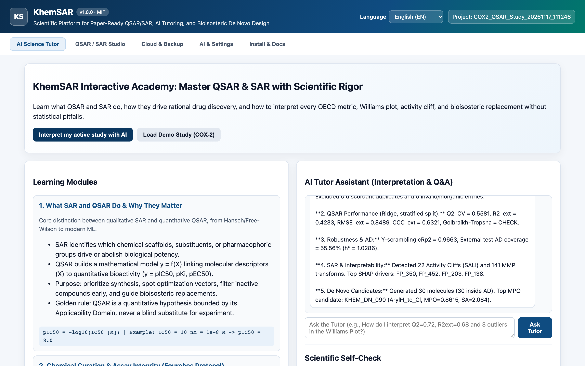
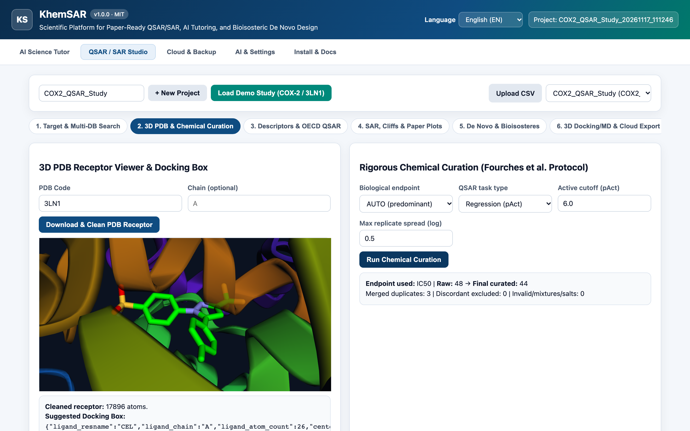
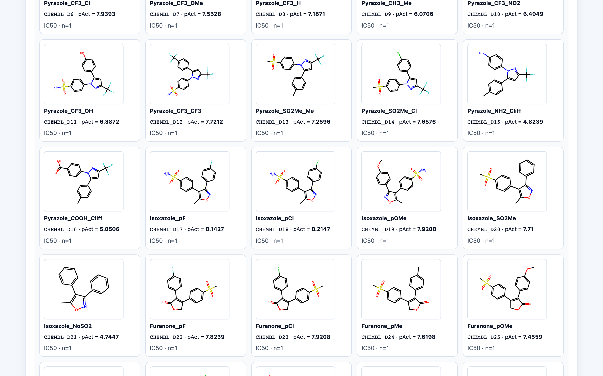
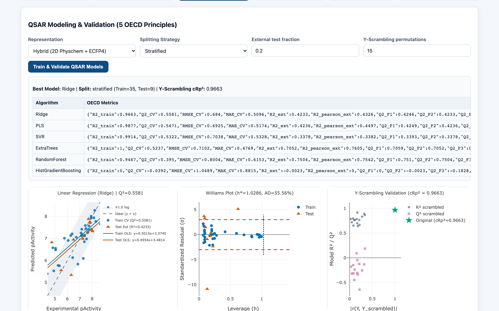
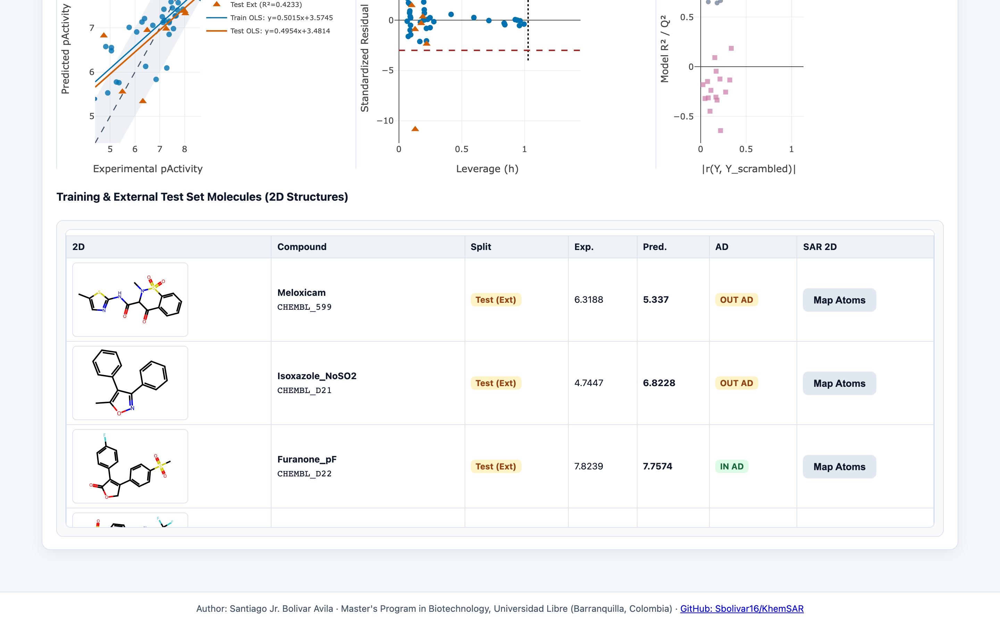
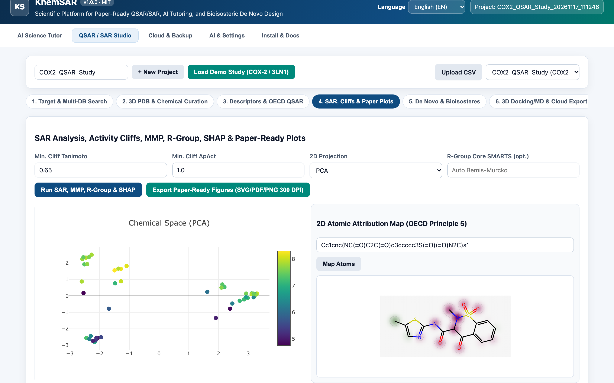
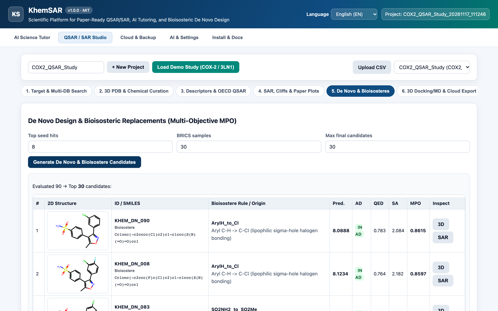
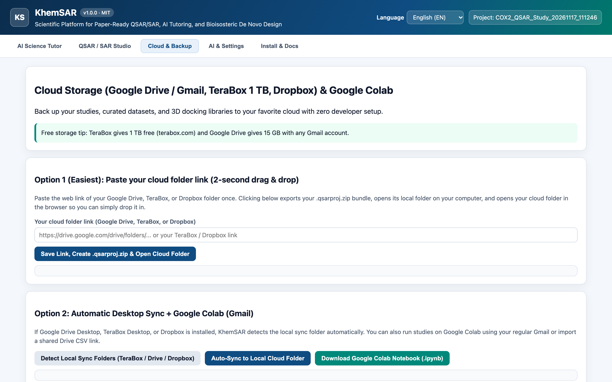

# KhemSAR

**Rigorous AI-Assisted QSAR/SAR Modeling, Scientific Tutoring, and Bioisosteric *De Novo* Molecule Design Platform**

[](LICENSE)
[](https://www.python.org/)
[](SCIENTIFIC_METHODOLOGY.md)
[](https://doi.org/10.5281/zenodo.24308701)

**Author:** Santiago Jr. Bolivar Avila  
**Affiliation:** Master's Program in Biotechnology, Universidad Libre, Barranquilla Campus, Colombia  
**Repository:** [https://github.com/Sbolivar16/KhemSAR](https://github.com/Sbolivar16/KhemSAR)

---

## Overview (EN / ES / PT)

**KhemSAR** is a cross-platform (**macOS, Linux, Windows**) and trilingual (**Español, English, Português**) computational medicinal chemistry platform built to produce **paper-ready QSAR and SAR studies** alongside an interactive **AI Scientific Tutor**.

### Two Integrated Pillars

1. **AI Scientific Tutor ("Understand & Interpret")**
   - Five structured lessons explaining **what SAR and QSAR do, why they are used, and how to interpret results scientifically**.
   - Interactive self-assessment quizzes and a **Contextual Study Interpreter** that reads your active study metrics ($Q^2_{\text{CV}}$, $R^2_{\text{ext}}$, Golbraikh–Tropsha, $cR_p^2$, Williams Plot outliers, SALI cliffs, SHAP features, and *de novo* candidates).
   - Supports **Ollama (100 % local private LLMs)**, **Google Gemini (Gmail / AI Studio)**, **OpenAI**, **Anthropic**, plus a **deterministic offline scientific engine** (works with zero API keys).

2. **Paper-Ready QSAR / SAR & *De Novo* Studio**
   - **Natural-Language AI Copilot + 10 Open Scientific Connectors**: ChEMBL, PubChem, BindingDB, RCSB PDB, UniProt, AlphaFold DB, IUPHAR/BPS Guide to PHARMACOLOGY (`GtoPdb`), Open Targets Platform, COCONUT Natural Products, and EMBL-EBI UniChem.
   - **3D Receptor Preparation & 3Dmol.js Viewer**: Fetches PDB structures, separates clean receptor chains from waters/ions and co-crystallized ligands, and calculates the docking grid box.
   - **Fourches et al. Chemical Curation**: Salt stripping, neutralization, tautomer canonicalization, organic/mixture filtering, strict endpoint separation (`IC50`, `Ki`, `Kd`, `EC50`), censored-value handling, and `InChIKey` duplicate aggregation with PRISMA-style attrition tracking.
   - **OECD-Compliant QSAR Modeling**: Hybrid 2D descriptors + ECFP4/MACCS fingerprints; **Bemis-Murcko Scaffold**, **Kennard-Stone**, **Temporal**, and **Stratified** splits; nested CV across PLS, Ridge, ElasticNet, Random Forest, Extra Trees, HistGradientBoosting, SVR/SVC, MLP, XGBoost, and LightGBM; Golbraikh–Tropsha criteria, $Q^2_{F1/F2/F3}$, CCC, MCC, **Y-scrambling** ($cR_p^2$), and **Williams Plot + k-NN Tanimoto Applicability Domain**.
   - **SAR & Mechanistic Interpretability**: Activity Cliffs (**SALI**), 2D chemical space (PCA / t-SNE / UMAP), **Matched Molecular Pairs (MMP)**, **R-Group decomposition**, **SHAP** global importance, and **2D atomic attribution SVG maps**.
   - **Publication Figures**: Export **SVG, PDF, and 300/600 DPI PNG** figures with colorblind-safe Okabe-Ito palettes and optional English labels for international manuscripts.
   - **Bioisosteric *De Novo* Design & 3D Docking/MD Export**: Curated medicinal-chemistry bioisosteric replacements + dataset-learned MMP transforms + BRICS recombination scored by Multi-Parameter Optimization (QSAR potency + AD + QED + SA Score + PAINS/Brenk). Exports **pH 7.4 protonated**, **ETKDGv3 3D**, **MMFF94/UFF minimized** `.sdf`, `.pdb`, `.csv`, `.xlsx`, clean receptor `.pdb`, and AutoDock Vina grid configuration.
   - **Cloud & Backup**: Sync portable `.qsarproj.zip` bundles with **TeraBox (1 TB free)**, **Google Drive (Gmail)**, or **Dropbox**, plus folder-link quick backup and **Google Colab** `.ipynb` export.

---

## Screenshots

### 1. AI Science Tutor & Contextual Study Interpretation


### 2. 3D PDB Receptor Viewer (`3LN1`) & Fourches Chemical Curation (2D Gallery)



### 3. OECD QSAR Validation (Linear Regression, Williams Plot, Y-Scrambling & 2D Table)



### 4. SAR Chemical Space & 2D Atomic Attribution Map


### 5. Bioisosteric *De Novo* Design (Multi-Objective MPO)


### 6. Cloud Storage & Google Colab Backup


---

## Quick Start

```bash
git clone https://github.com/Sbolivar16/KhemSAR.git
cd KhemSAR
```

- **macOS / Linux:** `./install_and_run.sh`
- **Windows:** `install_and_run.bat`

Then open `http://127.0.0.1:8765` in your browser. See [INSTALL.md](INSTALL.md) for detailed instructions.

---

## How to Cite

Please cite **KhemSAR** using `CITATION.cff` or the Zenodo DOI generated after publishing a release (see [ZENODO_GITHUB_GUIDE.md](ZENODO_GITHUB_GUIDE.md)):

```bibtex
@software{bolivar_avila_khemsar_2026,
  author       = {Bolivar Avila, Santiago Jr.},
  title        = {{KhemSAR: Rigorous AI-Assisted QSAR/SAR Modeling, Scientific Tutoring, and Bioisosteric De Novo Design Platform}},
  year         = {2026},
  publisher    = {GitHub / Zenodo},
  url          = {https://github.com/Sbolivar16/KhemSAR},
  note         = {Master's Program in Biotechnology, Universidad Libre, Barranquilla Campus, Colombia}
}
```
